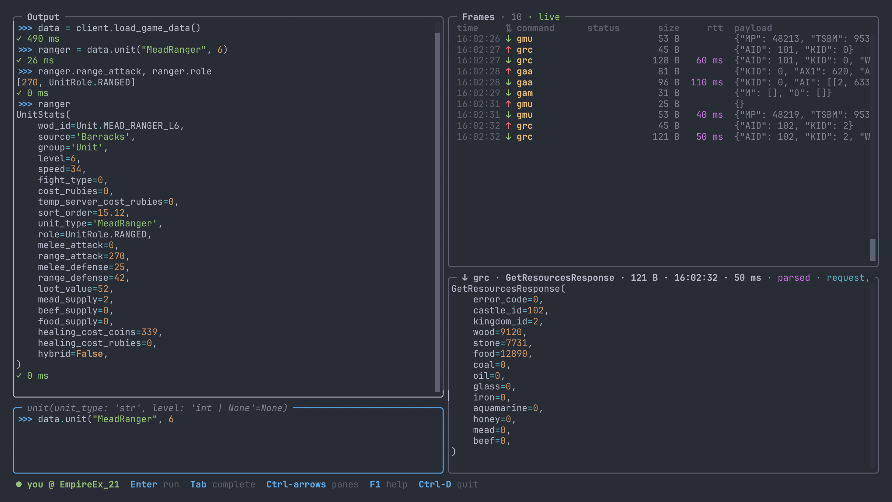

# Console

`empire-console` is a full-screen Python REPL with a logged-in `client` ready to use. You write
code on the left; every frame the connection sends and receives scrolls by on the right, parsed
into the same models the library returns.



It runs on Linux and macOS. It is untested on Windows: it may work there, but dragging to resize
the panes probably does not.

```bash
pip install 'empire-core[console]'

empire-console                        # asks for the username and password
empire-console --username your_user   # or set GGE_USERNAME / GGE_PASSWORD
empire-console --zone EmpireEx_3      # another world; US1 (EmpireEx_21) by default
empire-console --list-zones           # every world, the default marked *
python -m empire_core.console         # the same as empire-console
```

`--zone` looks the world up in the game's server list. The banner and the toolbar show the
account and its world, as `you @ EmpireEx_3`. `--no-login` starts without connecting, which is enough to explore the API with completion.
`--log-level INFO` shows the library's log in the output pane. `--theme light` starts in the
light theme; dark is the default, and F4 or `:theme` switches while it runs. Both themes paint
their own background, so they look the same whatever your terminal's colours are.

The console opens at once and logs in inside it, with a spinner in the toolbar and the login
frames arriving in the frame list. If the session drops (another login of the account, or the
connection going away), a red banner says so and `:login` logs in again, waiting out the
server's login cooldown first. `--keep-session` lets the library log in again by itself; its
retries, and whether the session came back, show in the output.

The console remembers its layout, theme, frame filter, detail mode and world between runs, in
`~/.config/empire-console/settings.json` (under `$XDG_CONFIG_HOME` when set); it never saves
credentials. `--theme` and `--zone` override what it remembers, and the next run keeps them.

## Writing code

`client` and `empire_core` are already in scope. Completion comes from jedi on the live objects,
so `client.castle.` lists the castle service's methods, and the input's title shows the signature
of the call the cursor is in. While the menu highlights a completion, a Docs panel above the input
shows its docstring. A line starting with `:` completes the console's commands instead, and their
arguments: theme names after `:theme`, and the commands seen so far after `:filter`.

`/` in Output or Detail searches it as you type; Enter keeps the match, and `n` and `N` jump to
the next and previous one.

```python
>>> castles = client.castle.get_all()
>>> castles[0].castle_name
```

Results print as indented models, sized to the pane, and the last one is kept as `_`. Each run
ends with `✓ 37 ms` (or `✗` when it raised). Enter runs the input once it is a complete statement;
a block (`for`, `def`, `with`) runs on an empty line, as in the Python REPL, and Esc then Enter runs
whatever is typed. Code runs on a worker thread, so frames keep streaming while a request waits;
the toolbar shows a timer while it runs. Ctrl-C stops it: the input is free again at once, and a
call still waiting for its reply ends quietly when its wait does. History is kept in
`~/.empire_console_history`.

## Reading frames

Each frame is one row: time, direction (`↑` sent, `↓` received), command, `✗` and the error code
on a refusal, size, round-trip time for a reply, and the start of the payload. Move to the
frame list (Ctrl-→ from Output, or click a row), then Up/Down/PgUp/PgDn to select, Home for the
oldest frame and End to follow the newest again.

The detail pane shows the selected frame, or the newest one while following. A reply the library
models is shown parsed into its response model, exactly as the client parses it, and a sent frame
into its request model; press `r` (or `:raw`) for the raw JSON payload. Frames without a model
and payloads that do not parse show raw, a reply that does not parse with a note saying why.

A reply and the request it answers are a pair: with one selected, the list marks the other with
`┆`, the detail title says how long the reply took, and `p` jumps between them. A request answered
under another command (a castle switch, `jca`, comes back as `jaa`) pairs all the same.

Every pane takes focus and scrolls. Ctrl and an arrow moves to the pane in that direction, F2
and Shift-F2 cycle through them, and a click focuses the pane under it. The mouse wheel scrolls
the pane it is over; each pane's scrollbar can be clicked or dragged. In Output and Detail,
arrows and PgUp/PgDn scroll and Home/End jump to the top or bottom. Output stays where you
scrolled it while new output arrives, and follows again once you return to the end.

Panes keep fixed sizes. Drag the border between the two columns, between Output and Python, or
between Frames and Detail to resize them.

Drag across text in Output or Detail to select it; it is copied when you let go, to the system
clipboard through your terminal (an OSC 52 escape; in tmux, `set -g set-clipboard on`). Ctrl-C
or `y` there copies the selection, or the whole pane when nothing is selected, and `c` in the
frame list copies the shown detail. Paste into the input with your terminal's paste key.

| Key | Does |
|-----|------|
| F1 | Help |
| Ctrl-arrows | Move to the pane in that direction |
| F2 / Shift-F2 | Next / previous pane |
| F3 | Zoom the focused side |
| F4 | Dark or light theme |
| Ctrl-L | Clear the output |
| Ctrl-D | Close the client and exit, as does `exit()` |

| Command | Does |
|---------|------|
| `:filter gbd gam` | Show only these commands; `:filter` alone shows all |
| `:grep text` | Show only frames containing `text`; `:grep` alone clears it |
| `:pause` | Freeze the view; frames are still recorded and appear on the next `:pause` |
| `:clear` | Forget every recorded frame |
| `:raw` | Toggle parsed and raw detail |
| `:theme [dark\|light]` | Switch the theme; alone, toggle it |
| `:save [file]` | Write the shown frames as JSON lines |
| `:run file.py` | Run a file as if typed: it sees `client`, keeps what it defines, and Ctrl-C stops it |
| `:login` | Log in again after the session drops |
| `:quit` | Close the client and exit |

Passwords, login tokens and bearer tokens never reach the pane or a saved file: login frames show
only their size, and credential fields in other frames are masked. The same frames are open to
your own code through `client.connection.add_frame_listener`.
